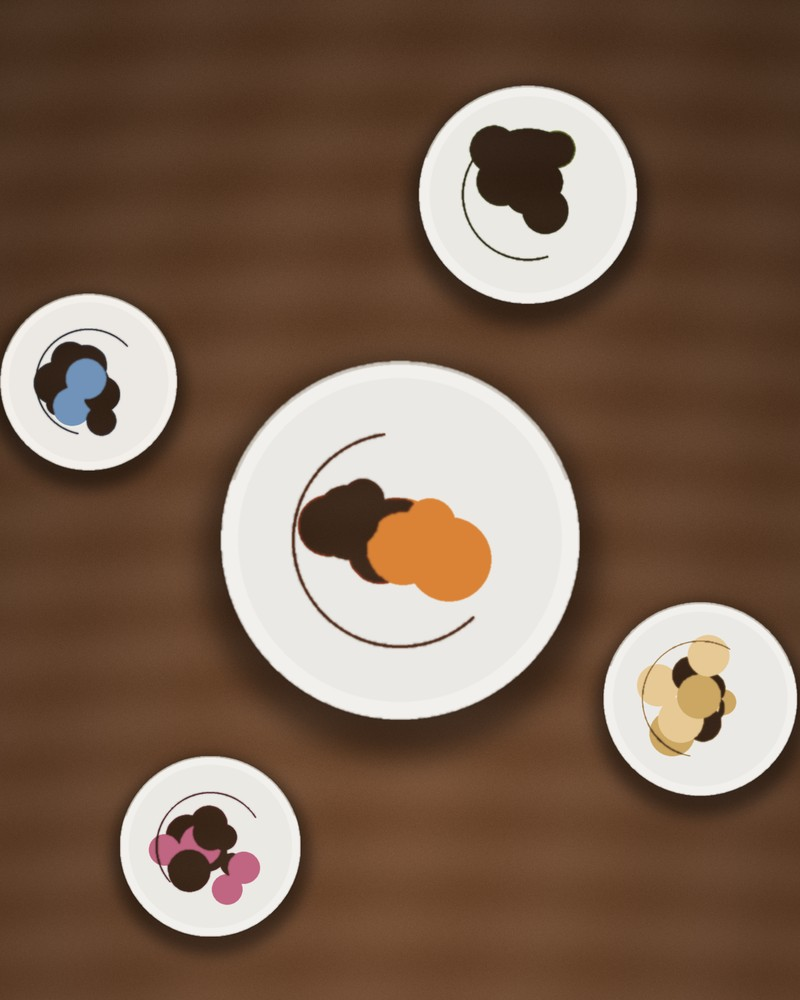

# Table Composer

把一张张单独拍的菜品照片，按摄影构图规则重新排到同一张桌面上。



输入 5 张单菜照片，输出一张 1200×1500 的餐桌排版图，外加一个记录每盘坐标和尺寸的 `layout.json`。

```
samples/dish_01.png ─┐
samples/dish_02.png ─┤
samples/dish_03.png ─┼─→ 分割 → 抠图 → 规则排版 → 投影合成 → out/result.png
samples/dish_04.png ─┤
samples/dish_05.png ─┘
```

## 这是什么，不是什么

**是**：一个声明式的餐桌排版引擎。菜品像素原样保留，不重绘、不生成、不改变食物本身。所有"好看"来自版式规则。

**不是**：生成式模型。它不会把菜画得更诱人，也不会把两张照片融合成一张新照片。成品看起来像排版过的菜单图，不像餐厅实拍。

这个取舍是刻意的：菜品真实可比融合感重要，规则可读可比模型可读重要。

## 快速开始

需要 Python 3.9+，只依赖 numpy 和 Pillow。

```bash
pip install -r requirements.txt

python scripts/make_samples.py          # 生成 5 张合成测试图
python compose.py --input "samples/*.png" --out out --bg wood
```

打开 `out/result.png`。

用真实照片时，装一个抠图模型，效果会好一个量级：

```bash
pip install rembg onnxruntime
python compose.py --input photos/*.jpg --out out --segment rembg --bg linen
```

## 参数

| 参数 | 默认 | 说明 |
|---|---|---|
| `--input` | 必填 | 图片路径或 glob，可给多个 |
| `--out` | `out` | 输出目录 |
| `--bg` | `wood` | `wood` / `linen` / `dark` / `solid` |
| `--segment` | `auto` | `auto` / `rembg` / `threshold` / `center` |
| `--width` `--height` | 1200×1500 | 画布尺寸 |
| `--main-ratio` | 0.48 | 主菜直径 / 画布宽度 |
| `--ring` | 0.42 | 配菜环绕半径 / 画布宽度 |
| `--angle0` | -90 | 第一道配菜的角度，改这个就能换布局 |
| `--headroom` | 0 | 顶部留白比例，给文字或人留位置 |
| `--feather` | 2.0 | 边缘羽化，单位是源图像素 |
| `--color-match` | 0.05 | 抠图向桌面色温靠拢的强度，0 关闭 |
| `--shadow` | 0.45 | 接触阴影不透明度 |
| `--seed` | 0 | 布局抖动种子，换一个就是另一种排法 |
| `--debug` | 关 | 额外输出带定位圈的 `debug.png` |

## 排版规则

主菜取面积最大的那张，放在画面中线略偏下的位置。其余按顺序铺在椭圆轨道上，带角度抖动、半径抖动和尺寸抖动。

布局不是一次算出来的：每次生成 16 组候选，按三项打分取最优——视觉重心离画面中心多近、盘子群占了多少画幅、有没有排成一条直线。最后一项是必要的，否则两道配菜会正好差 180 度，把画面排成一列。

重叠允许 12%，因为真实的桌子就是会叠。盘子不裁边，露一角在画面外看着像失误，不像构图。

所有盘子共用一个环形接触阴影：比盘子略大的椭圆，向下偏 3.5%，高斯模糊。这一步是"贴纸感"和"放在桌上"的分界线。

`layout.json` 记录每盘的中心坐标、直径和层级，手改之后用同样的 `--seed` 重跑就能复现同一版式。

## 分割后端

| 后端 | 适用 | 依赖 |
|---|---|---|
| `rembg` | 真实照片，推荐 | `pip install rembg onnxruntime` |
| `threshold` | 背景干净的图、合成测试图 | 无 |
| `center` | 兜底，假设菜在正中 | 无 |

`auto` 会优先用 rembg，没装就退回 threshold。真实照片上 threshold 基本不可用，它假设背景接近纯色。

## 数据

demo 用合成图就能跑通。接真实数据时用这两个学术数据集：

- **Food-101**：10.1 万张单菜照片，101 类，研究用途
  <https://data.vision.ee.ethz.ch/cvl/datasets_extra/food-101/>
- **FoodSeg103**：7118 张带像素级分割标注，103 类食材，研究用途
  <https://xkyong.github.io/FoodSeg103/>

```bash
python scripts/download_data.py --dataset food101 --dest data/
```

两个数据集都只允许学术研究使用，不要商用、不要重新分发。仓库里不放数据。

## 已知限制

- **只有单菜图，没有满桌图。** 学术数据集里没有"一桌菜"的样本，所以布局规则来自手工设定，不是学出来的。
- **相对大小靠排名推断。** 每张源图的拍摄距离不同，无法知道真实的盘子尺寸，只能按"主菜最大、其余递减"处理。
- **视角必须一致。** 全部按正俯拍处理。混入 45 度拍的照片，透视会打架。
- **不统一光照。** 每张原图的光向不同，拼起来高光方向会冲突。这是贴图路线的天花板。

## 路线图

- [x] v0 分割、抠图、规则排版、接触阴影、色温匹配
- [ ] v1 每盘独立光向估计，阴影方向跟着原图走
- [ ] v2 局部 inpainting：只重绘盘沿环带和阴影区，菜像素不动
- [ ] v3 用 FoodSeg103 微调分割，替代 rembg

## 结构

```
compose.py             CLI 入口
src/segment.py         分割后端
src/cutout.py          抠图、羽化、色温匹配
src/layout.py          排版规则（核心）
src/render.py          背景、阴影、合成
scripts/make_samples.py 合成测试图
scripts/download_data.py 数据集下载
```

## 许可

代码 MIT。数据集各有各的许可，见 `NOTICE`。
